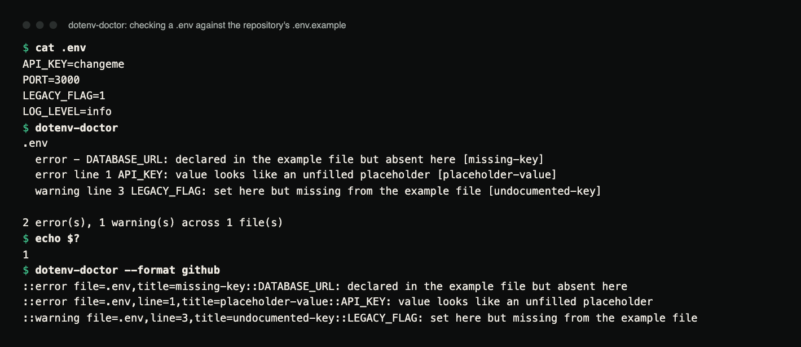
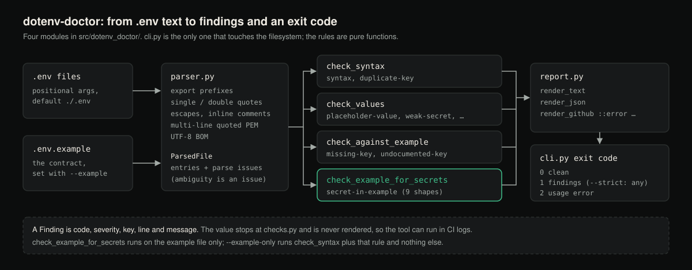

# dotenv-doctor

Validate `.env` files against a committed `.env.example`, and catch the
configuration mistakes that otherwise only show up after a deploy.

[](https://github.com/hellpuffyt/dotenv-doctor/actions/workflows/ci.yml)
[](LICENSE)

[Case study ↗](https://hellpuff.dev/work/dotenv-doctor)

**Status:** version 0.1.0, beta. Python 3.10 or newer, no runtime
dependencies. CI runs the test suite on Linux, macOS and Windows with Python
3.10 to 3.13. Not published to PyPI (see [Installation](#installation)).

## Demo

A dependency-free CLI that reads your `.env` files and tells you what is wrong
with them before your application does. Given this `.env` next to the
repository's own [`.env.example`](.env.example):

```dotenv
API_KEY=changeme
PORT=3000
LEGACY_FLAG=1
LOG_LEVEL=info
```

```console
$ dotenv-doctor
.env
  error - DATABASE_URL: declared in the example file but absent here [missing-key]
  error line 1 API_KEY: value looks like an unfilled placeholder [placeholder-value]
  warning line 3 LEGACY_FLAG: set here but missing from the example file [undocumented-key]

2 error(s), 1 warning(s) across 1 file(s)
$ echo $?
1
```

A `-` in place of a line number means the finding is about the file as a
whole: a key that should be present and is not.



*Terminal capture of the run above (real output, rendered from the saved
transcript), followed by `--format github` on the same file.*

## Why does it exist?

`.env.example` is a promise: *these are the variables this service needs.*
Nothing enforces it. The file drifts, and the failures all look the same from
the outside, a service that boots fine locally and dies in staging.

The mistakes this catches are ordinary, and all of them are invisible until
runtime:

- A new required variable was added to `.env.example` but never to the deploy
  environment.
- A placeholder like `changeme` was committed and then shipped as if real.
- A *real* credential was pasted into `.env.example` and committed to git.
- A key is assigned twice in one file and the earlier value is silently ignored.
- A value has trailing whitespace that the loader keeps and the API rejects.

Most `.env` linters check syntax. This one checks the relationship between
your real environment and the contract your repository publishes.

## Features

- **Example-contract checking.** Missing keys are errors, undocumented keys
  are warnings.
- **Placeholder detection.** A list of 27 template values (`changeme`, `todo`,
  `xxx`, `<your-key>`, an empty value and so on) is matched against the whole
  value, so a real secret that merely contains `changeme` is not flagged.
- **Weak-secret detection.** Applies only to credential-shaped key names
  (`*SECRET*`, `*TOKEN*`, `*PASSWORD*`, `*API_KEY*` and similar) and flags a
  value shorter than 8 characters or below 2.5 bits of Shannon entropy per
  character. `PORT=3000` is short and low-entropy, and is left alone.
- **Committed-credential detection.** Nine live-credential shapes (AWS access
  key IDs, GitHub, Slack, Stripe, OpenAI, Anthropic and Google API keys, PEM
  private keys, JWTs) are errors when found in the example file.
- **A parser for the awkward cases.** `export` prefixes, inline comments (also
  after a quoted value), `pass#word`, single vs double quoting with escapes,
  values containing `=`, multi-line quoted values such as PEM keys, and a
  UTF-8 byte-order mark. An unterminated quote or an unquoted multi-line PEM
  block is reported as a syntax error instead of being guessed at.
- **Three output formats:** human text, JSON for tooling, and GitHub Actions
  workflow commands that annotate the diff.
- **Exit codes CI can branch on:** `0` clean, `1` findings, `2` usage error.

## Architecture



*Diagram of the data flow between the four modules.*

Four modules, each testable on its own:

```
src/dotenv_doctor/
├── parser.py    text  → entries + parse issues   (no rules, no I/O opinions)
├── checks.py    parsed data → findings           (pure functions, no filesystem)
├── report.py    findings → text / JSON / GitHub  (no logic, only rendering)
└── cli.py       argument parsing and wiring      (the only module doing I/O)
```

The split lets the rule set be tested without a filesystem, and means a new
output format cannot change a rule's behaviour.

`parser.py` implements the *intersection* of what mainstream `.env` loaders
agree on (python-dotenv, docker-compose, foreman, direnv) rather than
inventing a shell parser. Anything ambiguous is recorded as a parse issue.

## Installation

> **Not on PyPI.** The name `dotenv-doctor` on PyPI belongs to an
> **unrelated project**, so `pip install dotenv-doctor` installs that other
> package, not this one. Install from this repository instead.

From source:

```bash
git clone https://github.com/hellpuffyt/dotenv-doctor
cd dotenv-doctor
python3 -m venv .venv && . .venv/bin/activate   # Windows: .venv\Scripts\activate
pip install -e ".[dev]"
```

Or straight from git, pinned to a commit you have reviewed:

```bash
pip install "git+https://github.com/hellpuffyt/dotenv-doctor@<commit-sha>"
```

Requires Python 3.10 or newer. No runtime dependencies; `[dev]` adds pytest,
pytest-cov, ruff and mypy.

## Usage

```bash
# Check ./.env against ./.env.example
dotenv-doctor

# Check several environment files at once
dotenv-doctor .env.staging .env.production

# A differently named reference file
dotenv-doctor --example env.sample

# Fail the build on warnings too
dotenv-doctor --strict

# Skip keys that are intentionally environment-only
dotenv-doctor --ignore SENTRY_DSN,BUILD_SHA

# Check syntax and values only, ignoring the example contract
dotenv-doctor --no-example
```

Run `dotenv-doctor --help` for the full option list.

### Options

| Option | Description |
| --- | --- |
| `-e`, `--example PATH` | Reference file (default `.env.example`; a file named explicitly must exist) |
| `-f`, `--format FORMAT` | `text`, `json`, or `github` (default `text`) |
| `--strict` | Treat warnings as failures |
| `--ignore KEYS` | Comma-separated keys to skip |
| `--no-example` | Skip the example-contract comparison |
| `--example-only` | Audit the example file alone (syntax + committed credentials) |
| `--no-colour`, `--no-color` | Disable ANSI colour (also off when stdout is not a TTY or `NO_COLOR` is set) |
| `-V`, `--version` | Print the version |

## Examples

Both examples use the `.env` from the top of this page.

**JSON output**, for piping into other tooling:

```console
$ dotenv-doctor --format json
{
  "summary": {
    "files": 1,
    "errors": 2,
    "warnings": 1
  },
  "files": [
    {
      "path": ".env",
      "errors": 2,
      "warnings": 1,
      "findings": [
        {
          "code": "missing-key",
          "severity": "error",
          "key": "DATABASE_URL",
          "line": null,
          "message": "declared in the example file but absent here"
        },
        {
          "code": "placeholder-value",
          "severity": "error",
          "key": "API_KEY",
          "line": 1,
          "message": "value looks like an unfilled placeholder"
        },
        {
          "code": "undocumented-key",
          "severity": "warning",
          "key": "LEGACY_FLAG",
          "line": 3,
          "message": "set here but missing from the example file"
        }
      ]
    }
  ]
}
```

**GitHub Actions output**, which annotates the file in the pull request:

```console
$ dotenv-doctor --format github
::error file=.env,title=missing-key::DATABASE_URL: declared in the example file but absent here
::error file=.env,line=1,title=placeholder-value::API_KEY: value looks like an unfilled placeholder
::warning file=.env,line=3,title=undocumented-key::LEGACY_FLAG: set here but missing from the example file
```

## Configuration

There is no configuration file. Everything is a flag, so a check can be
reproduced from the command line alone. For repeated invocations, put the
flags in a `Makefile` target or your CI step.

## Findings reference

| Code | Severity | Meaning |
| --- | --- | --- |
| `missing-key` | error | In the example file, absent from the checked file |
| `placeholder-value` | error / warning | Unfilled template value; error when the key is credential-shaped |
| `secret-in-example` | error | A real credential shape found in the committed example |
| `syntax` | error | Line is not a valid assignment |
| `undocumented-key` | warning | Set in the real file, missing from the example |
| `duplicate-key` | warning | Assigned more than once; the last assignment wins |
| `weak-secret` | warning | Credential-shaped key with a short or low-entropy value |
| `unquoted-whitespace` | warning | Leading or trailing whitespace without quoting |

## Testing

```bash
pytest                       # the suite (116 tests)
pytest --cov=dotenv_doctor   # with coverage
ruff check .                 # lint
mypy                         # type check (strict)
```

The suite covers the parser's edge cases (quoting, escapes, multi-line values,
inline comments), each rule on its own including its false-positive guards,
and the CLI end to end through a temporary directory. CI runs the same
commands, plus a job that runs `dotenv-doctor --example-only` on this
repository's own `.env.example`. The last full audit is written up in
[docs/PRODUCTION_READINESS.md](docs/PRODUCTION_READINESS.md).

## Using it in CI

With the `github` format, findings appear as inline annotations on the pull
request:

```yaml
- name: No credentials committed in the example file
  run: |
    # Not on PyPI (the PyPI name is an unrelated project): install from git,
    # pinned to a commit you have reviewed.
    pip install "git+https://github.com/hellpuffyt/dotenv-doctor@<commit-sha>"
    dotenv-doctor --format github --example-only
```

`--example-only` is the variant that works in a public CI job. It audits the
committed example file for syntax errors and real credentials **without
needing a real `.env`**, and it skips the placeholder and weak-secret rules,
because an example file is meant to be full of placeholders.

To validate a real deployment environment instead, check the actual file:

```yaml
- name: Validate environment contract
  run: dotenv-doctor --format github --strict .env.production
```

## Security

- **No value is ever printed.** Findings name the key and describe the
  problem; the value never reaches stdout or stderr, so running this in CI
  cannot leak a secret into build logs. `tests/test_no_value_leak.py` checks
  this for every rule, every output format and every parse-error path with
  secret-shaped values, including fragments of a pasted private key. What
  *is* printed: key names, line numbers, and for `weak-secret` the value's
  length or entropy. Parse errors never repeat the offending line, and an
  invalid "key" (which may be a stray fragment of a secret) is not repeated
  either.
- GitHub workflow-command output escapes file names and messages as GitHub
  documents, so a crafted file name cannot inject extra commands.
- **Nothing is sent anywhere.** No network access, no telemetry, no runtime
  dependencies.
- **Credential detection is shape-based**, using published prefix formats. It
  will not catch a credential with no recognisable shape. Treat it as a safety
  net, not a guarantee.
- `.gitignore` excludes `.env` and `.env.*` while keeping `.env.example`.

To report a vulnerability, see [SECURITY.md](SECURITY.md).

## Limitations

- Credential detection is shape-based (see Security), and secrets in comments
  of the example file are not inspected.
- If `.env.example` is absent and `--example` is not given, the contract
  checks are skipped with a note on stderr. An explicitly given `--example`
  file that does not exist is a usage error (exit 2).
- Only UTF-8 input is supported (a BOM is accepted).

## Roadmap

Not implemented yet:

- A `--fix` mode that appends missing keys to `.env` as commented stubs.
- Type annotations in the example file (`PORT=  # int`) with value validation.
- A pre-commit hook definition.

## Contributing

See [CONTRIBUTING.md](CONTRIBUTING.md) for setup, the checks a pull request
must pass, and how to add a rule. Changes are recorded in
[CHANGELOG.md](CHANGELOG.md).

## License

MIT, see [LICENSE](LICENSE).
